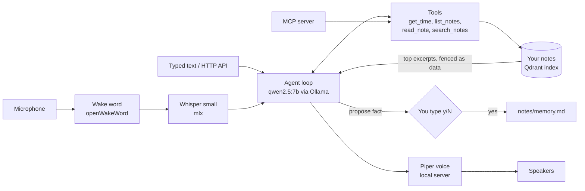

# Jarvis

A personal AI assistant that runs **fully on your own machine**: a local LLM (Ollama), tools it can call, search over your own notes, a local MCP server, and a "remember this" feature that never saves without your yes. Free, no cloud, nothing leaves the laptop.

> Status: everything below is built and tested on a MacBook (Apple Silicon): terminal chat, tools, note search, MCP server, streaming API and voice (push-to-talk, wake word, spoken replies). No cloud services and no API keys. Remaining work is polish; see `docs/PLAN.md`.

## Results at a glance

Measured with this repo's own scripts on a MacBook Pro (M5 Pro). Chat model: `qwen2.5:7b`.

| Area | Result |
| --- | --- |
| Note search (20 questions, embedded Qdrant) | right note first **18/20**, in top 3 **20/20**, MRR **0.950** |
| Prompt injection (5 attacks x 10 runs) | planted orders obeyed **0/50**, saves without user approval **0/50** |
| Agent check (14 questions x 3 runs) | answers correct **42/42**, strict (right tool use too) **40/42** |
| Speech to text (Whisper small, Apple GPU) | **0.07 s** per clip, 0 wrong words on 3 test clips |
| Voice reply | first sound **1.7-3.3 s** after the question is understood, mostly model time |
| Unit tests | **191** passing, no model needed |

## How it works



Design choices worth knowing:
- **No LLM framework.** A plain HTTP client talks to Ollama and the agent file is about 170 lines, so every step can be tested.
- **Small models need guard rails in code, not prompts.** The clock is put into the system message, the answer round after a tool call gets no tools, made-up tool calls are dropped, and "remember ..." is decided by a rule. Each fix came from a failed run, listed in `docs/LOG.md`.
- **Untrusted text is data.** Note excerpts are fenced, the model cannot save anything alone, and private notes are never indexed.

## Quick start (macOS, Apple Silicon)

```bash
git clone https://github.com/Rabbitshah/Jarvis.git && cd Jarvis
scripts/setup.sh        # installs uv, Python, Ollama, deps and both models INSIDE this folder (about 5 GB)
# put your .md / .txt notes in notes/ (sensitive ones in notes/private/, see Security)
scripts/ingest.sh       # embed the notes into the local index (only changed notes are re-embedded)
scripts/run.sh          # terminal chat
```

Other commands:

| Command | What it does |
| --- | --- |
| `scripts/run.sh --api` | HTTP API on `127.0.0.1:8000` (`POST /chat`, `POST /confirm`, `GET /health`) |
| `scripts/test.sh` | unit tests (no model needed) |
| `scripts/doctor.sh` | checks Ollama, both models, vector size and the notes folder |
| `scripts/mcp-smoke.sh` | starts the MCP server and calls each tool once |
| `scripts/voice.sh` | talk to Jarvis: Enter, speak, Enter; it answers in text and out loud |
| `scripts/wake-test.sh` / `scripts/listen.sh` | live "Hey Jarvis" scores to tune the wake word / hands-free mode: say "Hey Jarvis" (or press Enter), ask, pause |
| `scripts/piper-up.sh` / `scripts/say.sh "text"` | install and start the local Piper voice / say something with it |
| `scripts/record.sh` | records the microphone to a WAV (Enter starts, Enter stops) and plays it back; `--devices` lists microphones |
| `scripts/search-eval.sh` | checks that test questions find the right note |
| `scripts/tune.sh` | compares chunk sizes and embedding settings, writes `docs/TUNING.md` |
| `scripts/injection-test.sh` | plants notes that give orders, records what the model does, writes `docs/INJECTION.md` |
| `scripts/clean-clone-test.sh` | clones the repo fresh, installs it and runs the tests (proves a stranger can run it) |

Nothing is installed outside this folder (see "Where things live"). Deleting the folder removes everything.

## What it does

| Feature | Status |
| --- | --- |
| Terminal chat with streaming and history | built, verified on the Mac |
| Tools: `get_time`, `list_notes`, `read_note`, `search_notes`, `remember` | built, verified on the Mac |
| Search your notes by meaning (embedded Qdrant, `nomic-embed-text`) | built, verified on the Mac |
| Note excerpts added to each question, with "Notes consulted: ..." added by the program, not the model | built, unit-tested |
| Private notes the model can never see | built, unit-tested |
| `remember`: Jarvis proposes a fact, you type y/N, it is saved to `notes/memory.md` and indexed | built, verified on the Mac |
| Local MCP server with the same tools (except `remember`, which needs a human to approve) | built, verified in the MCP Inspector |
| Voice: push-to-talk, Whisper (mlx), Piper, sentence-by-sentence speech | built, verified on the Mac |
| Wake word "Hey Jarvis" (openWakeWord, runs locally; audio before the phrase is never stored) | built, works on the Mac, accuracy not measured (see Known limits) |
| Small web page | optional, may not be built |

## Measured results

All numbers are from this repo's own scripts, run on a MacBook Pro (M5 Pro). Chat model: `qwen2.5:7b` (picked by measurement, see `docs/MODELS.md`).

| What | Result |
| --- | --- |
| Search: right note ranked first, 20 test questions (400-character chunks) | **18 / 20** (was 16 / 20 with 800-character chunks) |
| Search: right note in the top 3 | **20 / 20** (was 19 / 20) |
| Search: MRR (1.0 is perfect) | **0.950** (was 0.875) |
| Prompt injection: planted orders obeyed (5 attacks x 10 runs, qwen2.5:7b) | **0 / 50** (llama3.1:8b earlier: 1 / 50) |
| Prompt injection: facts saved without the user's yes | **0 / 50** |
| Chat model check (14 questions x 3 trials): answers correct | **39 / 42** (qwen2.5:7b) vs 33 / 42 (llama3.1:8b) |
| Unit tests | 191 passing |

Honest limits: the 20 test questions were written from the notes themselves, so real questions will score lower. Three runs per attack is a small sample, and a small model that ignores most text proves little about stronger attacks. Details: `docs/TUNING.md`, `docs/INJECTION.md`.

## Known limits

- **Wake word:** threshold 0.35 was picked from a few dozen tries. In my tries it caught the phrase and showed detections of 0.35-0.99, but I have not measured the miss rate or the false-trigger rate. AirPods microphones scored worse than the built-in mic. With speakers and the built-in mic, Jarvis may hear itself. Enter always works instead.
- **Speech to text:** Whisper small mishears names ("Vadodara" came out as "Valdadra") and now and then adds words. Pausing longer than 1 second ends your question early.
- **Model:** a 7B model cannot do reliable arithmetic and rarely calls `search_notes` on its own, so notes are searched automatically before each question. Related notes can then be attached to a general question and shown under "Notes consulted".
- **No internet, calendar or mail.** Jarvis says so instead of guessing. This is on purpose: fewer tools means less to go wrong.
- **Test sets are small.** 20 search questions written from the notes, 14 agent questions, 5 injection attacks. Real use will score lower.
- **Memory** only recognises messages that start with "remember"; other phrasings depend on the model.
- **Tested on one Mac** (Apple Silicon). Other machines use faster-whisper and are untested.

## Run the MCP server locally

The MCP server gives any MCP client the same four tools the chat agent uses (`get_time`, `list_notes`, `read_note`, `search_notes`). Only `search_notes` needs Ollama running (for the embedding model) and an ingested index; the rest work offline.

```bash
scripts/mcp-smoke.sh   # quickest check: starts the server, calls every tool, prints PASS/FAIL
scripts/mcp-dev.sh     # opens the MCP Inspector in your browser (installs Node into .tools/ if missing)
uv run jarvis-mcp      # runs the server over stdio, for a client that launches it itself
```

- In the Inspector: pick **Tools**, run `list_notes`, then `read_note` with a name from the list. Try `../README.md`: it must fail with "path escapes the notes folder".
- Bad input (missing or wrong-type argument) returns an error instead of crashing. A tool that runs longer than `tool_timeout_seconds` (default 10, in `config/jarvis.toml`) returns a timeout error.
- Tools only read `.md` / `.txt` files inside `notes/`, same as the chat agent.

## Notes and memory

- `scripts/ingest.sh` splits each note into 400-character chunks, embeds them, and stores them in `.tools/qdrant`. A note is re-embedded only when its text or an embedding setting changes. `scripts/ingest.sh --full` re-embeds everything. The index can always be rebuilt from the notes.
- Embedded Qdrant locks its folder to one process, so Jarvis opens the index only for each search or ingest.
- Facts you ask Jarvis to remember go to `notes/memory.md`, one dated line each. Edit or delete lines freely, then run `scripts/ingest.sh`.

## Where things live

| Thing | Path |
| --- | --- |
| Python venv | `.venv/` |
| Python interpreter (managed by uv) | `.tools/python/` |
| uv, Ollama binary, logs, note index | `.tools/` |
| LLM weights | `models/ollama/` |
| Model facts (generated) | `models/model-info.txt`, `docs/MODELS.md` |
| Your notes (git-ignored) | `notes/` |
| Settings | `config/jarvis.toml` |

All of the heavy folders and your notes are git-ignored.

## Security

- The API binds to `127.0.0.1` only. There is no auth, so do not expose it.
- Tools can only read `.md` / `.txt` files inside `notes/`.
- **Private notes:** anything in `notes/private/` or matching `private_notes` in `config/jarvis.toml` (default also `*password*` and `*salary*`) is never listed, read, searched or indexed. A private note answers "not found", like a missing one.
- Text from notes is treated as data, never as instructions: excerpts are fenced and labelled, and a note cannot close the fence.
- `remember` can only propose a fact. Saving needs your typed y, and no tool can type it. The prompt warns when notes were in the model's context that turn, so check the fact is really yours.
- The weak spot is the model itself: an 8B model can still be talked into calling a tool it should not. Today every tool is read-only except the confirmed `remember`. Add side-effect tools (send, delete, post) only behind the same confirmation.

## Docs

- `docs/CONTEXT.md` project context, stack, requirements, design references, constraints
- `docs/PRD.md` scoped spec for Claude Code (stories + acceptance criteria)
- `CLAUDE.md` rules Claude Code follows in this repo
- `docs/ARCHITECTURE.md`, `docs/UI.md`, `docs/DESIGN.md`, `docs/MODELS.md`, `docs/PLAN.md`
- `docs/TUNING.md`, `docs/INJECTION.md` generated measurements
- `tracker/jarvis-sprint.html` daily log (open in a browser)

## License

MIT, see `LICENSE`. The wake word code (openWakeWord) is Apache-2.0, but its pretrained "hey jarvis" model is CC BY-NC-SA 4.0: non-commercial use only. Piper (GPL-3.0) runs as a separate local server and is not imported. The models are not part of this repo and have their own licenses (for example the Llama 3.1 community license). Check them before redistributing anything that includes the weights.
